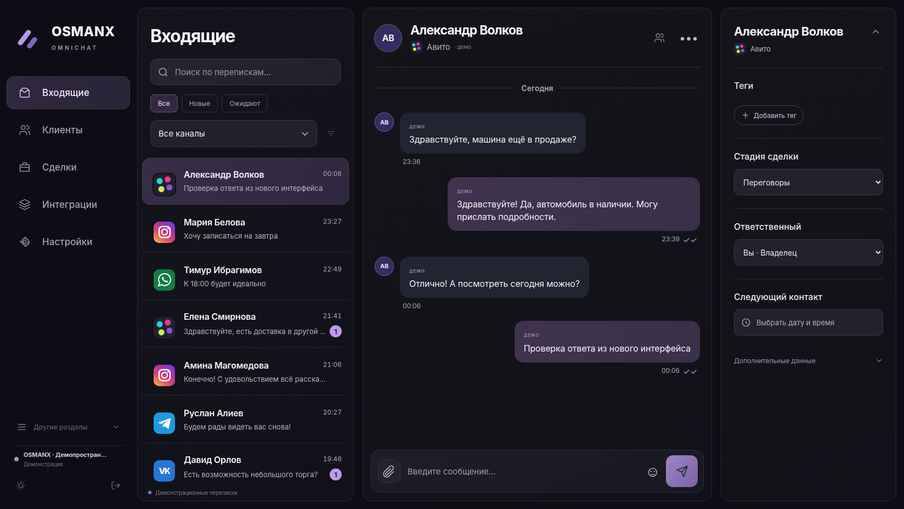
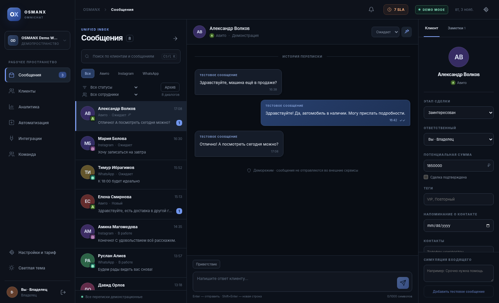
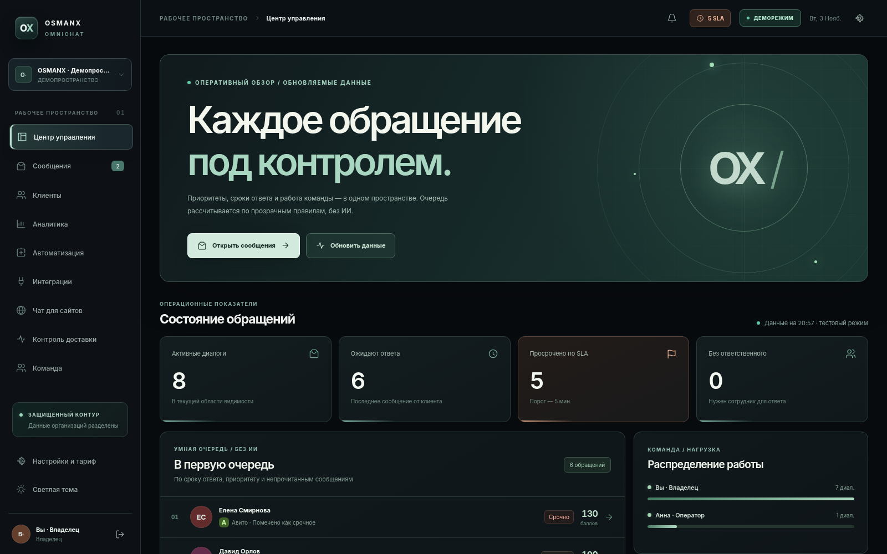

## R36 — outbound dispatch safety (integrated on R35)

R36 retains R35 inbound tenant fairness and adds tenant-scoped outbound controls:

- Outbound pauses for all channels or a single channel; SQL gates **new** claims but cannot recall provider requests already in flight.
- Append-only, data-minimized delivery transition log covering worker actions, operator cancellation and verified retry.
- Privacy-filtered diagnostic support report (aggregates, codes and metadata only; no message content, credentials, error strings or tenant identifiers).
- Admin-facing OBSIDIAN controls, mobile layouts at 390/320 px, and a regression suite (SQLite migration + FastAPI + Chromium).

Read [R36 engineering report](docs/R36_RELEASE_INTEGRATED_RU.md) and [GitHub publishing checklist](docs/GITHUB_PUBLISH_RU.md). R36 does not claim provider delivery from API acknowledgement. Live Telegram/WhatsApp/Avito integration still needs independent acceptance testing.

# OSMANX OMNICHAT R35 — справедливое распределение входящих и проверка целостности

**R35 (6 ноября 2026): четыре крупных блока действующего кода:**

1. SQL-планировщик с двумя уровнями справедливости: внутри каналов и между компаниями, включая сохранение последнего захвата компании в базе.
2. Проверка целостности входящей очереди: просроченные захваты, заброшенные блокировки, пустые технические записи и нарушения связи между компанией и каналом. Только агрегаты, без содержимого переписок.
3. Безопасное ограниченное восстановление: CAS для просроченных заданий и блокировок; исчерпанные попытки остаются на ручной проверке, живые обработчики защищены от принудительного освобождения. Причина и сотрудник фиксируются в аудите.
4. Русскоязычная OBSIDIAN-панель диагностики, отдельное подтверждение действия, серверные и браузерные тесты, миграция и CI.

[Технический отчёт R35](docs/RELEASE_R35_TENANT_FAIR_RECOVERY_RU.md) · [Протокол QA](docs/QA_R35_RU.md) · [Инструкция по восстановлению](docs/INBOUND_MAINTENANCE_R35_RU.md) · [Chromium: ПК](docs/preview-r35-integrity-desktop.png) · [Chromium: телефон](docs/preview-r35-integrity-mobile.png).

**Обновление R34 → R35:** остановите старые API и worker, сделайте проверенную копию БД и ключей шифрования, выполните `alembic -c backend/alembic.ini upgrade head`. Не смешивайте R34 и R35 на одной БД. PostgreSQL/четыре процесса проверяются отдельным CI-сценарием, но его локальный запуск не заявляется. Реальные соцсети, React 19 в активной сборке, production и платежи не тестировались.

---

# OSMANX OMNICHAT R34 — защищённая обработка входящих и проверяемое восстановление

**R34 (5 ноября 2026): четыре крупных изменения в коде:** (1) межсерверная SQL-блокировка одного входящего аккаунта с TTL и fencing; (2) немедленный ручной разбор события при потере ключа или повреждении зашифрованной структуры; (3) подписанный 90-секундный предпросмотр и строго проверяемое массовое восстановление с аудитом; (4) обновлённая OBSIDIAN-диагностика занятости и ошибок в русском интерфейсе, тесты и миграции.

[Технический отчёт R34](docs/RELEASE_R34_REVIEWED_INBOUND_RU.md) · [Протокол QA R34](docs/QA_R34_RU.md) · [Инструкция руководителю](docs/INBOUND_REVIEW_R34_FOR_OWNER_RU.md) · [Экран на ПК](docs/preview-r34-reviewed-inbound-desktop.png) · [Мобильный экран](docs/preview-r34-reviewed-inbound-mobile.png).

**Проверено локально:** 296/296 тестов (35 модулей), Chromium ПК/390/320 px, TypeScript, заполненная миграция R33→R34, Alembic check. **Не проверено локально:** реальные гонки PostgreSQL на независимых серверах (код CI добавлен), React 19 как активная сборка, реальные API, производство и платежи. **Обновление:** остановите все R33 API/worker, сохраните проверенную копию базы и ключей шифрования, примените миграцию `f34000a10001` через `alembic upgrade head`; нельзя смешивать R33 и R34 на одной базе.

---

# OSMANX OMNICHAT R33 — справедливая очередь и безопасное закрытие инцидентов

**R33 (5 ноября 2026): четыре крупных реализации в коде:** (1) SQL-планирование входящих с чередованием аккаунтов и общей отметкой последнего захвата; (2) подтверждённое необратимое закрытие ошибочных событий с немедленным удалением шифротекста и аудитом; (3) защищённый обзор загрузки и задержек по каналам без клиентского содержимого; (4) обновлённый русский OBSIDIAN-интерфейс, реальная браузерная проверка, миграция, CI и документация.

[Технический отчёт R33](docs/RELEASE_R33_INBOUND_FAIRNESS_RU.md) · [Инструкция при инциденте](docs/INBOUND_TRIAGE_R33_FOR_OWNER_RU.md) · [Результаты тестирования](docs/QA_R33_RU.md) · [Экран на ПК](docs/preview-r33-inbound-fairness-desktop.png) · [Мобильный экран](docs/preview-r33-inbound-fairness-mobile.png).

**Обновление с R32:** остановите старые API и worker, создайте проверенную резервную копию БД, отдельно сохраните ключи шифрования, распакуйте R33, выполните `alembic -c backend/alembic.ini upgrade head` и `alembic -c backend/alembic.ini check`; не запускайте разные версии поверх одной базы. Новая ревизия `f33000a10001`. Рабочий интерфейс legacy React, кандидат React 19 не включён. PostgreSQL-процессы в текущей среде не запускались, публичный деплой, платежи и реальные API соцсетей не затрагивались.

---

# OSMANX OMNICHAT R32 — входящие под контролем при сбое

**R32 (5 ноября 2026): четыре больших блока кода:** (1) отдельная пауза обработки входящих на уровне всей компании и отдельного live-канала, без потери подтверждённых webhook; (2) ограничение наполнения зашифрованной очереди по аккаунту с отказом `HTTP 503 + Retry-After` вместо ложного подтверждения; (3) постраничная история технических событий, фильтры и защищённое пакетное восстановление до 20 ошибок из интерфейса; (4) русскоязычный тёмный интерфейс, миграция R31→R32, QA/CI, изоляция данных компаний.

[Полный технический отчёт R32](docs/RELEASE_R32_INBOUND_CONTROL_RU.md) · [Как действовать владельцу](docs/INBOUND_INCIDENT_R32_FOR_OWNER_RU.md) · [Протокол QA R32](docs/QA_R32_RU.md) · [Скриншот ПК](docs/preview-r32-inbound-control-desktop.png) · [Телефон](docs/preview-r32-inbound-control-mobile.png).

**Установка с R31:** остановить все старые API/workers, создать проверенный бэкап, сохранить действующие ключи шифрования, затем `alembic -c backend/alembic.ini upgrade head` (новая ревизия `f32000a10001`). Никогда не запускать R31 и R32 одновременно на одной базе. Настройка `INBOUND_MAX_PENDING_PER_CHANNEL` по умолчанию 5000.

**Проверки:** SQLite/Alembic, локальный Chromium на 1512/390/320 px, новые серверные тесты и изолированная регрессия. Точный итог сохранён в QA-отчёте и `docs/qa_r32_module_results.json`. Реальная многосерверная PostgreSQL-гонка подготовлена для CI, но локально не выполнена. React 19 не активирован; рабочий runtime — legacy React. Реальные аккаунты соцсетей, продакшен-развёртывание и платежи не проверялись.

---

# OSMANX OMNICHAT R31 — надёжный зашифрованный приём входящих

**R31 (5 ноября 2026): четыре крупных блока кода** — (1) подписанные webhook-события сначала коммитятся в зашифрованной очереди, (2) фоновое восстановление с SQL-claim, пятью попытками и защитой от дублей, (3) русскоязычный экран контроля входящих и ручное восстановление с аудитом, (4) изоляция организаций, удаление по сроку хранения, новая миграция и тесты.

[Полный отчёт R31](docs/RELEASE_R31_DURABLE_INBOUND_RU.md) · [Инструкция для руководителя](docs/INBOUND_RECOVERY_R31_FOR_OWNER_RU.md) · [Протокол QA](docs/QA_R31_RU.md) · [Скриншот ПК](docs/preview-r31-inbound-recovery-desktop.png) · [Мобильный](docs/preview-r31-inbound-recovery-mobile.png).

**Проверка R31:** 262/262 серверных теста в 32 независимых модулях; Chromium ПК/390/320, TypeScript, новая Alembic-миграция и заполненная база R30 → R31 — PASS. PostgreSQL CI-тест не выполнялся локально.

**Обновление с R30 требует новой миграции** `f31000a10001`. Перед установкой остановите старые API/workers, сделайте проверенную резервную копию и сохраните ключи шифрования; инструкции в отчёте. Рабочий runtime по-прежнему legacy React; PostgreSQL в многосерверном режиме и реальные соцсети локально не проверены. Платежи и публикацию не запускали.

---

# OSMANX OMNICHAT R30 — первое обращение без дублей

**R30 (5 ноября 2026):** реальные SQL `INSERT ... ON CONFLICT DO NOTHING` защищают создание первого контакта, идентичности, диалога и сообщения, когда несколько webhook-обработчиков видят новый чат одновременно. Дубликат события не увеличивает счётчик непрочитанных; проигравшая спекулятивная карточка клиента удаляется в той же транзакции. Telegram/VK/MAX валидируют повреждённые подписанные JSON-события с HTTP 422; MAX использует безопасное время события. Это улучшения действующего серверного кода — не макет.

- [Отчёт R30](docs/RELEASE_R30_FIRST_CONTACT_RU.md) и [Инструкция эксплуатации](docs/FIRST_CONTACT_R30_OPERATIONS_RU.md)
- [QA R30](docs/QA_R30_RU.md), [Chromium ПК](docs/preview-r30-first-contact-desktop.png), [390 px](docs/preview-r30-first-contact-mobile.png), [320 px](docs/preview-r30-first-contact-phone320.png)
- Серверные сценарии: `PYTHONPATH=backend:. pytest -q backend/tests/test_r30_first_inbound_claim.py` — **25/25 новых тестов**.
- Полная проверка: `PYTHONPATH=backend:. python scripts/verify_r30_regression.py` — **251/251 в 31 независимом модуле** с кодом выхода 0. Chromium: ПК, 390 и 320 px.
- PostgreSQL/4 воркера: `scripts/verify_r30_postgres.py` в CI (не выполнялся в текущем локальном окружении).

**Важные ограничения:** R30 — локальная восстановленная ветка R19–R29, не production-версия. При обновлении сохраняйте базу, останавливайте старые обработчики и не запускайте разные версии API на одной БД. Новая миграция для R30 не требуется. React 19, реальные соцсети, PostgreSQL в локальной среде, платежи и развёртывание не заявляются проверенными.

---

# OSMANX OMNICHAT R29 — входящие без потери непрочитанных

**R29 (5 ноября 2026):** атомарные счётчики и версия переписки при параллельных входящих, корректный порядок запоздавших событий, защита «Прочитано» по версии действительно показанного диалога. Тёмный русскоязычный интерфейс сохранён. **Новую миграцию БД добавлять не нужно**, но перед обновлением сделайте резервную копию и остановите старые серверы.

- [Технический отчёт R29](docs/RELEASE_R29_ATOMIC_INBOUND_RU.md)
- [Инструкция оператору](docs/UNREAD_R29_FOR_OPERATORS_RU.md)
- [Скриншот теста 1512 px](docs/preview-r29-incoming-race-desktop.png), [390 px](docs/preview-r29-incoming-race-mobile.png), [320 px](docs/preview-r29-incoming-race-phone320.png)
- [Протокол QA R29](docs/QA_R29_RU.md)

**Честный статус:** локальная инженерная сборка. Настоящие аккаунты соцсетей не подключены; PostgreSQL в этом окружении недоступен, React 19/Vite ещё не установлен. Production и платежи не затронуты.

---

# OSMANX OMNICHAT R28 — подтверждённые ответы и достоверный SLA

**Новое:** после нажатия «Отправить» платформа больше не считает диалог обработанным, пока ответ не подтверждён API или виджетом сайта. Ошибки, очередь и неопределённые отправки видны в метриках. Исправлены «Просрочено по SLA», «Ожидают ответа» и приоритизация Центра управления. Для новых ответов фиксируется **точное время API-подтверждения**, а не создания черновика.

**Проверено:** 217/217 серверных тестов в 10 независимых наборах; SQLite Alembic upgrade/drift; заполненная база R27→R28; TypeScript; Chromium на 1512, 390 и 320 px. Настоящие соцсети не подключали, React 19 ещё не активирован.

[Что изменилось и как обновить](docs/RELEASE_R28_DELIVERY_TRUTH_RU.md) · [Объяснение показателей для владельца](docs/ANALYTICS_R28_FOR_OWNER_RU.md) · [Протокол QA](docs/QA_R28_RU.md) · [Снимок интерфейса](docs/preview-r28-delivery-truth-desktop-queued.png)

---

# OSMANX OMNICHAT R27 — стабильная отправка одного аккаунта

**Новое в R27:** при одновременной работе нескольких API/worker процессов OSMANX резервирует **один SQL-слот внешнего аккаунта**. Параллельные отправки из одного Telegram/WhatsApp/Instagram/Авито и других поддерживаемых аккаунтов больше не должны пересекаться; разные компании продолжают обслуживаться. Heartbeat обновляет владение отправителем и заданием одной транзакцией, а старый обработчик не может снять чужую блокировку.

**Для руководителя:** в «Контроль доставки» добавлено «Сейчас отправляют: N аккаунтов». Новых обязательных действий для оператора нет. Существующие индивидуальные и глобальные паузы R25/R26 сохранены.

**Проверки:** 205/205 серверных сценария прошли в отдельных процессах, SQLite миграция R26→R27 и TypeScript проверены, Chromium проверен на ПК и телефонах 390/320px. Единый процесс pytest по-прежнему иногда зависает — он не считается успешно завершённым. PostgreSQL в этой среде не запущен. Реальные соцсети и React 19 также не испытывались.

[Отчёт R27](docs/RELEASE_R27_SENDER_SERIALIZATION_RU.md) · [Простое объяснение для владельца](docs/QUEUE_R27_FOR_OWNER_RU.md) · [QA R27](docs/QA_R27_RU.md) · [Скриншот рабочего интерфейса](docs/preview-r27-sender-serial-desktop.png)

**Осторожно при обновлении:** сначала остановите все процессы R26 и сделайте проверенную резервную копию; не смешивайте старые и новые workers на одной БД. При чистой установке Windows — `start_windows.bat`, Linux — `./start_linux.sh`, затем `http://127.0.0.1:8000`.

---

# OSMANX OMNICHAT R25 — Аварийная пауза исходящих

Теперь владелец или администратор может **приостановить новые исходящие сообщения конкретного аккаунта**, не отключая поступающие сообщения клиентов. Очередь пропускает временно остановленный канал, другие компании и аккаунты работают дальше. Оператор видит предупреждение прямо в Inbox, а изменение записывается в журнал.

**Проверка:** 181/181 серверных тестов в пяти независимых наборах, компиляция TypeScript, миграция R24 → R25 и Chromium на 1512/390/320px. **Реальный PostgreSQL в текущей среде не запускался**, отдельная проверка предусмотрена в GitHub Actions. React 19 пока не установлен (npm DNS `EAI_AGAIN`); рабочий интерфейс сохраняется на React 16. Публичной публикации, платежей и подключения реальных соцсетей не было.

[Полный отчёт R25](docs/RELEASE_R25_EMERGENCY_PAUSE_RU.md) · [Краткая инструкция для владельца](docs/OUTBOUND_PAUSE_R25_FOR_OWNER_RU.md) · [QA](docs/QA_R25_RU.md)

**Локальный запуск:** Windows `start_windows.bat`, Linux/macOS `./start_linux.sh`, затем `http://127.0.0.1:8000`. Перед обновлением действующей базы остановите старые обработчики и сделайте проверенную резервную копию. Установите миграцию `alembic upgrade head` до запуска R25.

---

# OSMANX OMNICHAT R23 — защита исходящих ответов после аварии

**Что нового:** сохранение отметки *до* внешней отправки, автоматическое восстановление безопасно прерванной подготовки, отдельное удержание живого обработчика и карантин **неопределённой доставки** после начала HTTP-запроса. В журнале фиксируется восстановление, старый процесс не перезаписывает решение нового. Ручная сверка руководителя также защищена от конкурентной перезаписи.

**На экране «Контроль доставки»:** «Подготовка до отправки», «Запрос передан площадке» и компактный показатель «Восстановлено безопасно». Интерфейс на русском, тёмный, адаптивный. Существующие WhatsApp-шаблоны и CRM сохранены.

**Проверка:** 161/161 серверных тестов в четырёх независимых группах; новая SQLite-миграция, TypeScript, браузерные сценарии ПК/390/320 px. Единый монолитный прогон может не завершать процесс после успешной печати итогов — это открытое ограничение тестового окружения. PostgreSQL и настоящие соцсети в текущей среде не проверялись.

**Запуск:** Windows `start_windows.bat`; Linux/macOS `./start_linux.sh`; откройте `http://127.0.0.1:8000`.

**ВАЖНО при обновлении:** обязательно остановите R22 worker и сервер, сделайте проверенную резервную копию и примените миграцию `alembic upgrade head` *до* нового запуска. Одновременная работа R22 и R23 с одной базой не поддерживается. Публичную публикацию, платежи и подключение настоящих аккаунтов не выполняли.

[Отчёт R23](docs/RELEASE_R23_FAILSAFE_OUTBOX_RU.md) · [Инструкция для руководителя](docs/OUTBOX_RECOVERY_R23_RU.md) · [Протокол QA](docs/QA_R23_RU.md)

---

# OSMANX OMNICHAT R22 — безопасный контроль исходящих ответов

**Новое:** в разделе **«Контроль доставки»** можно отменить ответ **до начала** обработки и, после однозначного отказа API, вручную подтвердить и поставить повторную попытку в очередь. Отмена и повтор атомарно проверяют состояние задания и права пользователя; неизвестную доставку не повторяют. Все действия записываются в аудит компании.

**Сборка:** сохраняются тёмный русскоязычный React-интерфейс, полноценный Inbox, длинная история диалогов, WhatsApp-шаблоны, сайт-чат, роли сотрудников и миграции предыдущих этапов. Для локального запуска: `start_windows.bat` или `./start_linux.sh`, затем `http://127.0.0.1:8000`.

**Проверки:** 146/146 Python-тестов в двух независимых группах; Chromium ПК/390/320 px; TypeScript. Не подтверждено: React 19, реальные соцсети, нагрузочная работа PostgreSQL и production-аудит. Публикацию и платежи не выполняли.

[Что изменилось](docs/RELEASE_R22_OUTBOX_SAFETY_RU.md) · [Инструкция для руководителя](docs/OUTBOX_R22_FOR_MANAGER_RU.md) · [Протокол проверок](docs/QA_R22_RU.md)

---

# OSMANX OMNICHAT R21 — совместная работа без потери изменений

**Главное исправление:** изменение статуса, закрепления и ответственного диалога теперь атомарно проверяет актуальную версию. Если коллега уже изменил диалог, интерфейс обновляет данные и просит повторить действие вместо того, чтобы перезаписывать его работу. Активный ответ нельзя украсть простым переназначением.

**Проверки:** **136/136 серверных тестов прошли в двух независимых группах**, TypeScript, SQLite Alembic upgrade/check, Chromium ПК/390/320. Проверка реальной гонки на PostgreSQL 16 включена в CI, но локально не запускалась. Подробности: [отчёт R21](docs/RELEASE_R21_TEAM_SAFETY_RU.md), [протокол QA](docs/QA_R21_RU.md) и [инструкция для операторов](docs/TEAM_COLLABORATION_RU.md).

**Статус:** локальный MVP восстановленной ветки R19/R20/R21. React 19 ещё не включён (рабочая сборка — React 16), публичный деплой, реальные социальные аккаунты, биллинг и платежи не запускались.

**Запуск:** Windows `start_windows.bat`; Linux/macOS `./start_linux.sh`. Открыть `http://127.0.0.1:8000` после установки зависимостей Python 3.12+. Перед обновлением существующей установки создать резервную копию базы.

---

# OSMANX OMNICHAT R20 — Длинные переписки без пропущенных ответов

**Новое:** приложение больше не застревает на первых 500 сообщениях клиента. Открывается самая свежая история (120 сообщений), остальные подгружаются кнопкой «Показать более ранние сообщения». Ускорена загрузка длительных диалогов, исправлены порядок сообщений с одинаковым временем и сохранение прочитанной истории при обновлениях. Добавлены ограничения доступа и индекс БД.

**Запуск:** `start_windows.bat` (Windows) или `./start_linux.sh` (Linux/macOS), затем `http://127.0.0.1:8000`. Перед обновлением сделать проверенную резервную копию и применить миграции Alembic.

[Технический отчёт R20](docs/RELEASE_R20_LONG_HISTORY_RU.md) · [Как читать историю — инструкция](docs/HISTORY_FOR_OPERATORS_RU.md) · [Настоящий экран ПК](docs/preview-r20-long-history-desktop.png) · [Мобильный экран](docs/preview-r20-long-history-mobile.png).

**Проверено:** 130/130 pytest, TypeScript, миграция R19→R20, Chromium ПК/390/320, WhatsApp-шаблоны. [Протокол QA](docs/QA_R20_RU.md).

**Статус:** локальная сборка на основе восстановленной R19; React 19 и реальные соцсети ещё не проверены. Публикация и платежи не выполнялись. Нельзя заменять рабочую базу без backup и сверки.

---

# OSMANX OMNICHAT — R19 RECOVERED / Approved WhatsApp Templates

**Важно:** это **новый восстановленный релиз из доступного архива v1.5**, а не побайтовая копия ранее выпущенного v1.8. Основные функции промежуточных версий восстановлены и заново тестируются. **Не перезаписывайте единственную установленную базу или рабочую папку** без резервной копии и сравнения с актуальным экземпляром.

**Новое в R19:** официальные одобренные текстовые шаблоны WhatsApp за пределами 24-часового окна, проверка статуса в Meta перед постановкой в очередь и перед отправкой, ручной реестр согласий, безопасный отзыв, параметры и тёмное русскоязычное окно выбора. Нет неофициального парсинга и обещаний доставки без ответа Meta.

**Запуск локально:** Windows `start_windows.bat`, Linux/macOS `./start_linux.sh`; откройте `http://127.0.0.1:8000`. Для новой установки нужен Python 3.12+ и возможность установить зависимости. Для прежней базы — резервная копия, затем `alembic upgrade head`.

[Описание релиза и восстановления](docs/RELEASE_R19_RECONSTRUCTION_RU.md) · [Как использовать WhatsApp-шаблоны](docs/WHATSAPP_APPROVED_TEMPLATES_R19_RU.md) · [Скриншот настоящего интерфейса](docs/preview-wa-template-desktop.png)

**Проверки:** 125/125 Python-тестов, TypeScript, Alembic upgrade/check, Chromium ПК/390/320. [Отчёт QA](docs/QA_R19_RECOVERY_RU.md).

**Не production:** клиентские аккаунты, внешние API и платежи не подключались, React 19 не активирован, PostgreSQL не проверен под нагрузкой. Публикацию и платежи не выполняли.

---

# OSMANX OMNICHAT v1.5 — Safe Recovery

**Главное изменение:** безопасное резервное копирование перед изменением схемы и надёжная проверка копий для восстановления. Не требует подключения внешних соцсетей и не меняет утверждённый тёмный интерфейс.

**Что проверено:** **111/111 автоматизированных тестов**, пробное восстановление SQLite с сохранением всех 26 таблиц и ревизии Alembic, контроль целостности архивов и исключение баз пользователей из ZIP-релиза. Проверка PostgreSQL выполнена в тестах с подменой внешних процессов; настоящий Docker/PostgreSQL в этой среде отсутствует.

[Короткая инструкция резервного копирования](docs/BACKUP_AND_RESTORE_RU.md) · [Отчёт по v1.5](docs/RELEASE_V1_5_RU.md)

**Ограничения:** фронтенд всё ещё на React 16, несмотря на подготовленный путь перехода на React 19. Боевые соцсети, публичная публикация и платежи не затрагивались.

---

# OSMANX OMNICHAT v1.4 — Worker Health & React 19 Transition

**Что реально изменилось:** сервер фиксирует состояние фоновых обработчиков и завершённых циклов отправки в общей базе; экран «Контроль доставки» показывает простое объяснение, когда отправка работает, ожидает или остановилась. Добавлена миграция данных, не затрагивающая чаты клиентов. Исправлено скрытое меню на узких телефонах.

**В коде подготовлен отдельный React 19.3.1 + Vite 8.3.5 entrypoint**, но **не включён в проверенную сборку**: npm-реестр в среде разработки недоступен. По умолчанию продолжается React 16, поэтому до production остаётся важное обновление. Не путайте подготовленный путь миграции с успешно установленным React 19.

**Проверено:** **101/101 Python-тест**, TypeScript текущего UI, обновление SQLite v1.3 → v1.4 с сохранением компании и канала, `alembic check`, реальный Chromium на ПК/390/320 px. **Не проверено:** React 19-браузерная сборка, PostgreSQL/Docker в целевом окружении, настоящая доставка через официальные соцсети.

**Быстрый запуск:** распакуйте ZIP, на Windows запустите `start_windows.bat`, на Linux/macOS — `./start_linux.sh`; откройте `http://127.0.0.1:8000`. Python 3.12+ и pip нужны при первом запуске. Для тестирования нажмите «Открыть демоверсию».

[Подробный отчёт v1.4](docs/RELEASE_V1_4_RU.md) · [Как проверить очередь](docs/WORKER_HEALTH_RU.md) · [План перехода на React 19](docs/REACT19_MIGRATION_RU.md) · [Настоящий интерфейс контроля доставки](docs/preview-v14-worker-desktop.png)

Публикация, платежи, реальные аккаунты и несогласованные подключения **не выполнялись**.

---

# OSMANX OMNICHAT — v1.3 Shared Core & Fair Queue

**Новое:** общие SQL-лимиты для регистрации/деморежима/виджетов, подтверждённая работа справедливой очереди между компаниями, безопасная проверка доверенных прокси, ограниченная обработка зависших заданий и отказ production-сервера при отставшей миграции базы. Тёмный русскоязычный интерфейс и Inbox сохранены. **Статус: локальный MVP; не production.**

**Проверено:** 94 backend-теста, миграция v1.2 → v1.3 с сохранением данных, чистый `alembic check`, TypeScript и Chromium. **Не проверено:** живые соцсети, Docker/PostgreSQL под нагрузкой, React 19 (реестр npm здесь недоступен). Публикацию и платежи не выполнял.

**Запуск:** Windows — `start_windows.bat`; Linux/macOS — `./start_linux.sh`; затем `http://127.0.0.1:8000`. Требуется Python 3.12+ с возможностью установки зависимостей. Для знакомства — деморежим, для собственных аккаунтов — регистрация отдельной организации.

[Отчёт v1.3](docs/RELEASE_V1_3_RU.md) · [Прокси, лимиты и очереди](docs/SCALING_AND_PROXY_RU.md) · [Скриншот контроля доставки](docs/preview-v13-operations-desktop.png)

---

# OSMANX OMNICHAT — v1.2 Reliability & Clarity

**Что нового:** атомарная защита от повторных webhook-событий при одновременной обработке, дополнительные проверки границ компаний перед отправкой, SQL-аналитика без загрузки всей истории, приоритетная очередь проблем и простой русскоязычный раздел «Что сделать сейчас». Тёмный дизайн и единый Inbox сохранены. Текущая версия — локальный MVP; публикация и платежи отложены.

**Запуск:** Windows `start_windows.bat`; Linux/macOS `./start_linux.sh`; открыть `http://127.0.0.1:8000`. При первом запуске нужен Python 3.12+ и доступ к установке зависимостей.

**Документация v1.2:** [релиз и проверки](docs/RELEASE_V1_2_RU.md) · [как разбирать проблемы с отправкой](docs/OPERATIONS_RUNBOOK_V12.md) · [реальный скриншот экрана доставки](docs/preview-v12-operations-desktop.png).

**Остаётся сделать до production:** подтвердить реальные официальные подключения, обновить React 16 (npm из данной среды недоступен), испытать PostgreSQL/Docker под нагрузкой, провести security-аудит, настроить HTTPS. Ни одна соцсеть не объявляется подключённой на основании тестового ответа API.

---

# OSMANX OMNICHAT v1.1 — Secure Operations

**Что нового:** защита входа на уровне общей базы, завершение сеансов других устройств в русскоязычных настройках, безопасный повтор сообщений и серверный лимит Web Chat, ускоренная обработка подтверждений WhatsApp. Утверждённый тёмный интерфейс сохранён.

**Запуск:** Windows — `start_windows.bat`, Linux/macOS — `./start_linux.sh`; после запуска откройте `http://127.0.0.1:8000`. Потребуется Python 3.12+ и установка зависимостей. В деморежиме реальные соцсети не задействуются.

**Важно:** реальные аккаунты соцсетей не подключались; приём платежей и публичная публикация не выполнялись. React 16 остаётся техническим долгом до получения зависимостей и сборки React 19. Обязательны HTTPS, права официальных API и проверка работы каждого канала.

- [Что изменено, что проверено и что остаётся](docs/RELEASE_V1_1_RU.md)
- [Как управлять сеансами — инструкция владельцу](docs/SESSIONS_FOR_OWNER_RU.md)
- [Реальный скриншот раздела безопасности](docs/preview-v11-security-desktop.png)
- [Мобильная версия](docs/preview-v11-security-mobile.png)

---

# OSMANX OMNICHAT v1.0 -- CONNECTOR ASSURANCE

**Current status:** locally executable platform with Russian UI, verified multi-tenant roles, official-channel adapters, in-app setup, evidence-based channel probes, and truthful outgoing delivery statuses. No paid subscriptions, public deployment, or unapproved accounts are activated.

**Start:** Windows `start_windows.bat`, Linux/macOS `./start_linux.sh`; open `http://127.0.0.1:8000`. For the first run: Python 3.12+, install dependencies. To connect your own social accounts, register a real workspace rather than opening Demo Mode.

**New in v1.0:** one-click read-only provider connection check; provider-side Telegram/MAX webhook comparison; 30-second server cooldown and tenant-bound authorization; monotonic WhatsApp delivery receipts; distinct queued/API-accepted/delivered/read/uncertain message labels; quick-start only counts externally accepted replies. No social platform is claimed operational without live credentials and permission.

**Verification:** 71/71 backend tests, successful TypeScript build, Alembic migrations with old data retained, Chromium checks at desktop/390px/320px through a local FastAPI bridge. Third-party responses in automated tests are mocked, and do not prove a real channel connection.

- [Release report / tested and missing](docs/RELEASE_V1_0.md)
- [Steps for connection owners](docs/CONNECT_V1_0_RU.md)
- [Desktop screenshot of real React + FastAPI](docs/preview-v10-connector-desktop.png)
- [Mobile screenshot of real React + FastAPI](docs/preview-v10-connector-mobile.png)
- [Original user guide in Russian](docs/EASY_START_RU.md)

---

# OSMANX OMNICHAT v0.9 — Clarity First

**Запускаемый локальный MVP**, ориентированный на максимально простой путь: зарегистрировать компанию, выбрать канал, получить сообщение и ответить. Важные изменения в v0.9 — реальный быстрый старт из трёх шагов, настройка одной соцсети за раз, черновики при переключении диалогов и идемпотентная отправка после потерянного ответа сети. Утверждённый тёмный Obsidian Silence сохранён.

**Запуск:** распакуйте архив → Windows: `start_windows.bat`, Linux/macOS: `./start_linux.sh` → `http://127.0.0.1:8000`. Python 3.12+ и доступ к установке зависимостей нужны при первом запуске. Нажмите «Демоверсия» или зарегистрируйте отдельную компанию.

**Проверки:** 64 API/security-теста, TypeScript, реальный React в Chromium на ПК и телефонах, браузерная регистрация и сценарий повторной отправки после потери HTTP-подтверждения. Боевые соцсети, публикация и платежи **не** подключались.

- [Инструкция обычному пользователю](docs/EASY_START_RU.md)
- [Что именно реализовано](docs/RELEASE_V0_9.md)
- [Быстрый старт — скриншот Chromium](docs/preview-v09-start-desktop.png)
- [Подключение одного канала — скриншот Chromium](docs/preview-v09-choose-channel.png)

---

# OSMANX OMNICHAT v0.8 — Real Connect Readiness

**Новая версия: реальные механизмы подключения с доказуемыми статусами, без фиктивной синхронизации.** Проект остаётся локальным self-hosted MVP; платежи и публикация отложены.

**Что нового:** четыре проверяемых шага подключения в русском интерфейсе, серверная проверка регистраций Telegram `getWebhookInfo` и MAX `GET /subscriptions`, сохранение подтверждений внешнего API, безопасный сброс доказательств после смены токена, локальная проверка готовности сервера и новая миграция базы. Темный Obsidian Silence и единый Inbox сохранены.

**Быстро попробовать на Windows:** распакуйте архив → запустите `start_windows.bat` (Python 3.12+ и доступ к pip) → откройте `http://127.0.0.1:8000` → нажмите **«Открыть демоверсию»**. Для настройки собственных аккаунтов зарегистрируйте отдельную компанию и откройте **«Интеграции»**. Доступ к настоящим соцсетям требует официальных разрешений и доступного HTTPS сервера, которых в этом релизе не предоставлялось.

**Проверка:** 59 Python API/security тестов, TypeScript, миграции v0.7 → v0.8, Chromium desktop/mobile и настоящий React + FastAPI при тестовом транспорте. Этот результат **не является сертификацией production**.

- [Как подключить соцсети: обычному владельцу компании и администратору OSMANX](docs/CONNECT_REAL_CHANNELS_V08.md)
- [Инженерный отчёт v0.8](docs/RELEASE_V0_8.md)
- [Скриншот настоящего мастера подключения](docs/preview-v08-onboarding.png)

---

# OSMANX OMNICHAT v0.7 — OBSIDIAN SILENCE

**Полноценный исходный код приложения с новым тёмным интерфейсом, точно по утверждённому направлению.** Обновление касается настоящего React + TypeScript, CSS и встроенного JS, а не изображения-макета. Основа — предыдущий релиз v0.6 с backend и интеграционной архитектурой.

## v1.5 — Safe Recovery: защита данных при обновлении

Добавлен автоматический **снимок SQLite перед изменением схемы**, отдельные команды проверки и безопасного восстановления в **новый** файл. PostgreSQL-архив теперь создаётся только после проверки кодов завершения `pg_dump` и `pg_restore`; частичная копия при сбое не выдаётся за полноценную. Релизная ZIP-сборка исключает приватные базы и папку `backups`.

На Windows вручную запустите `backup_local_windows.bat`, на Linux/macOS — `./backup_local_linux.sh`. Подробности: [простая инструкция](docs/BACKUP_AND_RESTORE_RU.md) и [отчёт v1.5](docs/RELEASE_V1_5_RU.md).

**React 19 пока не внедрён в действующую сборку:** npm-зависимости недоступны для загрузки; рабочий UI остаётся на React 16. Публичная публикация и платежи не выполнялись.

## Запуск за один шаг

**Windows:** распакуйте архив, запустите `start_windows.bat`, после установки зависимостей откройте `http://127.0.0.1:8000` и нажмите «Открыть демоверсию». Нужны Python 3.12+ и доступ к установке пакетов.

**Linux/macOS:** `./start_linux.sh`, затем тот же локальный адрес. Node.js для обычного запуска не нужен — JS уже собран в `frontend/public/app.js`.

## Что изменилось в v0.7

- Реализован утверждённый **тёмный четырёхзонный интерфейс**: навигация → диалоги → переписка → карточка клиента.
- Переписаны входящие, карточка клиента, компактное меню действий, экран входа; добавлена рабочая доска сделок.
- Добавление и удаление тегов, редактирование стадии, ответственного, напоминания, заметки, отправка сообщения и фильтрация каналов остаются действиями на настоящем серверном API.
- Проверены 45 backend-тестов, Chromium E2E с настоящим FastAPI TestClient на ПК и телефонах 390/320 px, TypeScript-компиляция.
- Публикация, платежи и реальные подключения к соцсетям не выполнялись. Адаптеры требуют официальных разрешений и отдельного тестирования.

**Снимок реально отрисованного интерфейса:** 

[Подробный релиз](docs/RELEASE_V0_7.md) · [Дизайн-система](docs/DESIGN_V0_7.md) · [Мобильный экран](docs/preview-v07-mobile.png) · [Экран входа](docs/preview-v07-auth.png)

---

## Архивная документация предыдущей версии v0.6

# OSMANX OMNICHAT

**Единый центр общения с клиентами** · Self-hosted SaaS MVP · версия **0.6.0** · 4 ноября 2026 года

> **Реальное приложение, не макет.** Исходники React/TypeScript, серверные API, база данных, миграции, Docker Compose, проверки, документация. Авито, Instagram и WhatsApp подключаются только официальными способами. Без выданных разрешений и действительных токенов никакое реальное подключение не считается рабочим.



[Проверенный мобильный вид](docs/preview-mobile.png)

## v0.6 CUSTOMER-OWNED CHANNELS — свои аккаунты у каждой компании

**Самообслуживание компаний:** пользователь регистрирует собственную организацию, создаёт дополнительные рабочие области в «Настройки и тариф → Ваши компании», выбирает собственные разрешённые каналы в «Ещё разделы → Интеграции» и отвечает на сообщения в одном Inbox. Данные и токены двух компаний не смешиваются: серверная проверка членства, ограничения прав и частичный SQL-индекс по внешнему аккаунту.

**Каналы:** Авито, Instagram, WhatsApp Business, Telegram-бот, сообщество ВКонтакте, MAX-бот, Facebook Messenger Page, собственный чат сайта. Для Facebook Pages и WhatsApp добавлены официальные сценарии привязки через Meta, но реальная авторизация требует одобренного Meta-приложения. Подготовлены проверки webhook/HMAC, права доступа, контроль статуса и обработка исходящих через прежний outbox. Нельзя читать личные переписки произвольных пользователей.

**Проверено локально:** 45 backend-тестов, TypeScript, Alembic, настоящий Chromium desktop/mobile и отдельный путь регистрации компании. **Внешние API смоделированы контрактными ответами:** живые бизнес-аккаунты, одобрение Meta, публичный HTTPS, production Docker/PostgreSQL и реальные платежи не выполнялись. Веб-чат сайта по-прежнему полноценно проверяется локально.

[Подключение для клиентов](docs/CUSTOMER_ONBOARDING_V06.md) · [Администратору платформы](docs/PLATFORM_OWNER_SETUP_V06.md) · [Отчёт v0.6](docs/RELEASE_V0_6.md) · [Скриншот процесса подключения](docs/preview-v06-onboarding.png)

## v0.5 FOCUS INBOX — проще и сильнее

**Новый спокойный интерфейс:** только Inbox, Клиенты, Аналитика на виду; «Ещё разделы» открывает CRM-связанные настройки; фильтры и настройки диалога скрываются до запроса; карточка клиента открывается отдельной кнопкой. Сохранены все функции v0.4, мобильная версия от 320 px.

**Единый Inbox в деморежиме:** 9 диалогов из 7 каналов — Авито, Instagram, WhatsApp, Telegram, ВКонтакте и MAX. Собственный чат сайта остаётся рабочим каналом в локальной среде.

**Добавлены официальные серверные адаптеры для Telegram-ботов, сообществ VK и ботов MAX**. Проверка токенов, защищённые входящие webhooks, маршрутизация в Inbox, отправка ответа через прежнюю очередь, дедупликация, разграничение организаций. Настоящие аккаунты не предоставлены: это проверенный через контрактные тесты код, **не** живая проверка провайдеров. Токен не равен успешной интеграции; подключение ожидает подписанного webhook-события.

**Проверено:** 39 backend-тестов, TypeScript, in-process FastAPI + Chromium E2E на ПК и мобильном экране, отсутствие JS-ошибок и переполнения при 320 px. Публичный деплой, реальные аккаунты и платежи не запускались.

[Инструкция по каналам](docs/CHANNELS_V05.md) · [Релиз и тесты](docs/RELEASE_V0_5.md) · [Принципы дизайна](docs/DESIGN_FOCUS_V05.md) · [Скриншот Inbox](docs/preview-v05-inbox.png)

## v0.4 Obsidian Atelier — новый центр управления и полностью русскоязычный интерфейс



Релиз v0.4 — развитие настоящего приложения, а не создание декоративных изображений. Новые функции: **Центр управления** с объяснимой приоритетной очередью обращений, временем ожидания и SLA; изменяемые **четыре приоритета** с серверной блокировкой конфликтов; **сохранённые подборки** по фильтрам; **журнал действий по диалогу**; русскоязычные меню, кнопки и сообщения; светлая/тёмная темы; новое премиальное оформление на CSS; оптимизированные SQL-запросы и составные индексы. Чат сайта, CRM, роли, автоматизация и очередь доставки из v0.3 сохранены.

**Проверка релиза:** 34 backend-теста успешно, TypeScript без ошибок, чистая миграция и проверка соответствия модели, переход с v0.3 с сохранением данных, Chromium desktop/mobile и цикл сайт-виджета с реальным backend через TestClient. Без реальных подключений к платформам, без платежей и без публичного развёртывания.

[Что изменено](docs/RELEASE_V0_4.md) · [Приоритеты и SLA](docs/COMMAND_CENTER.md) · [Дизайн-система](docs/DESIGN_SYSTEM_RU.md) · [Актуальный инженерный статус](docs/STATUS.md)

Предпросмотры: [Inbox](docs/preview-v04-inbox.png) · [Мобильная версия](docs/preview-v04-mobile.png) · [Виджет клиента](docs/preview-v04-widget.png) · [Светлая тема](docs/preview-v04-light.png).

**Приоритеты пользователя:** реальные клиенты, публикация и платежи — позднее. В v0.4 эти действия не запускались.

## v0.3 World Edition - verified engineering additions

**New: First-Party Website Messenger**. Configure a widget in the **Sites / Web Chat** page, copy the one-line `<script>` snippet, and embed it on an allowed website. Visitor messages now enter the same Inbox as external-channel messages; staff replies are returned to the visitor widget. Demo-mode traffic remains visibly labeled. Unlike third-party connectors, this channel does not need Avito or Meta credentials. See [installation and security guide](docs/WEBSITE_CHAT.md).

- **Team collaboration:** timed server-side conversation claims/release; conflicting employee replies receive HTTP 409; no silent overwrites.
- **Operational visibility:** scoped outbox dashboard, explicit unknown-delivery reconciliation with audit evidence, and dedicated Docker worker service.
- **International foundation:** per-company IANA timezone and ISO currency; daily analytics uses company timezone; changes that would reinterpret existing deal amounts are blocked.
- **Embed security:** whitelist iframe origins, visitor bearer token hashes at rest, 30-day session expiry, per-visitor rate limits, nonce deduplication, no visitor access to internal notes or other contacts. Launcher CSS is an external stylesheet to accommodate strict CSPs.
- **Verification:** 34 Python tests; TypeScript compilation; Alembic upgrade + drift check; Chromium renders the actual React UI and widget and exercises a real FastAPI **in-process** message roundtrip with no JavaScript errors. Due to execution-environment network policy, Chromium did not navigate to a publicly hosted endpoint. This is not a production network test.

Preview of the new management and visitor UI: [desktop](docs/preview-world-websites.png) | [mobile](docs/preview-world-mobile.png) | [visitor widget](docs/preview-world-widget.png).

[Release notes](docs/RELEASE_V0_3.md) | [Detailed status A-G](docs/STATUS.md) | [World roadmap and release gates](docs/WORLD_ROADMAP.md)

> **Scope completion at v0.3: approximately 67%**, not commercial readiness. Every external provider still requires permission from the business account owner and end-to-end verification. React 16 remains unsupported and must be upgraded before customer production deployment. No payment gateway or paid SaaS billing has been activated.

## Быстрый запуск

**Windows:** распакуйте архив и запустите `start_windows.bat` двойным щелчком (нужен установленный Python 3.12+ и доступ к pip).
**Linux/macOS:** выполните `./start_linux.sh`. Оба скрипта создают виртуальное окружение, устанавливают зависимости, применяют миграцию и запускают приложение локально на `http://127.0.0.1:8000`. При первом запуске нужно выбрать **«Открыть демоверсию»**.

## Начало работы за 3 минуты — локально

Необходимо: **Python 3.12+**, доступ к `pip`. Node.js для обычного запуска **не нужен** — приложение уже содержит скомпилированный React. Для редактирования TSX потребуется TypeScript.

```bash
# В корневой папке проекта
python -m venv .venv
source .venv/bin/activate           # Windows: .venv\Scripts\activate
pip install -r backend/requirements.txt
cp .env.example .env               # Windows PowerShell: Copy-Item .env.example .env
# Для простого локального демо не требуется редактировать .env
PYTHONPATH=backend alembic -c backend/alembic.ini upgrade head
PYTHONPATH=backend uvicorn app.main:app --host 127.0.0.1 --port 8000
```

**Откройте:** `http://127.0.0.1:8000` и нажмите **«Открыть демоверсию»**. Появятся 9 тестовых диалогов, 7 помеченных демоканалов, CRM, аналитика, заметки, команда и правила.

На Windows PowerShell без присваивания `PYTHONPATH=...`:

```powershell
python -m venv .venv
.venv\Scripts\Activate.ps1
pip install -r backend/requirements.txt
Copy-Item .env.example .env
$env:PYTHONPATH = "backend"
python -m alembic -c backend/alembic.ini upgrade head
python -m uvicorn app.main:app --host 127.0.0.1 --port 8000
```

`.env` загружается при локальном запуске автоматически (существующие переменные окружения имеют приоритет). `PUBLIC_BASE_URL` должен совпадать с адресом, открытым в браузере, особенно для WebSocket.

`DATABASE_URL` по умолчанию — `sqlite:///./omnichat.db`. Демо создаёт **новую изолированную организацию** и не обращается к внешним API.

## Альтернативный запуск — Docker Compose + PostgreSQL

```bash
cp .env.example .env
# Обязательно замените POSTGRES_PASSWORD на собственный URL-safe пароль
# Для локального демо оставьте APP_ENV=development, COOKIE_SECURE=false
# Если DATABASE_URL в .env указывает на SQLite, Docker всё равно использует PostgreSQL.
docker compose up --build -d
curl -f http://127.0.0.1:8000/api/health/ready
```

При первом запуске контейнер автоматически выполняет миграцию Alembic и запускает Uvicorn. Docker не установлен в среде, в которой собирался архив: **конфигурация подготовлена, но `docker compose up` здесь не проверялся**.

Для интернет-публикации необходимо настроить HTTPS, настоящий домен, DNS, `PUBLIC_BASE_URL=https://...`, `COOKIE_SECURE=true`, `APP_ENV=production`, `INTEGRATION_ENCRYPTION_KEY`, пароль БД, резервные копии и Webhook callback адреса. См. [production-runbook](docs/PRODUCTION.md).

## Что реально работает

- Регистрация компании, вход и выход, защищённые cookie-сессии, CSRF, переключение между организациями по членству.
- Отдельные организации с tenant-scoped SQL-запросами, роли владельца, администратора, руководителя, менеджера, оператора.
- Трёхколоночный Inbox: списки чатов, поиск по сообщениям и контактам, фильтры по каналу, статусу и ответственному, архив, pin, счётчик непрочитанного, карточка клиента.
- История сообщений, отправка тестовых ответов, optimistic lock по `version`, idempotency `client_nonce`, внутренние заметки, быстрые ответы, тестовые новые обращения.
- Карточки CRM, воронка, теги, суммы сделки, **разделение подтверждённой и потенциальной выручки**, ручное объединение идентичностей, дата напоминания.
- Команда, приглашения токеном (с проверкой пароля существующего пользователя), статус доступности, назначение оператора.
- Автоматизация по событиям: содержит фразу/всегда, назначение наименее загруженного оператора, тег, статус или закрепление.
- Аналитика, SLA-оповещения, выбор политики хранения, экспорт и удаление данных компании.
- WebSocket обновлений (+ запасное обновление раз в 7 секунд), адаптивная светлая/тёмная тема.
- Табличная SQL-очередь отправки, идемпотентное получение входящих сообщений, HMAC подписи Meta webhooks, повторные попытки только там, где это безопасно.
- Реальные **реализации адаптеров официальных API** Авито, Instagram и WhatsApp — не равнозначно пройденной внешней проверке. Реальные токены и разрешения не предоставлялись.
- Миграция Alembic, CI, Docker-файлы, 45 автоматических тестов и Chromium smoke-test интерфейса на ПК/телефоне.

## Не готово — перед платным запуском

1. **Проверить каждый внешний канал с разрешённым реальным аккаунтом**: OAuth/App Review, webhooks, реальная отправка и входящие; установить нужные бизнес-тарифы/разрешения. Текущая среда не имела этих доступов.
2. **Обновить vendored React 16.0 до поддерживаемой современной версии** (в данной среде загрузка npm из интернета недоступна). Текущая сборка работает, но устаревшая библиотека — блокер промышленного security review. Не скрывать это от покупателей.
3. Реализовать официальные медиа-ответы/шаблоны WhatsApp, полную синхронизацию истории Instagram, восстановление токенов и обработку всех видов вложений.
4. Перевести фоновую очередь на выделенный масштабируемый worker, добавить Redis/внешнюю rate-limit систему, расширить мониторинг и нагрузочные тесты.
5. Проверить Docker в целевой инфраструктуре, выполнить внешний security audit, сценарии восстановления из бэкапа, правовой аудит персональных данных и договоров с платформами.
6. Реальные платежи и подписки **не подключены**: серверные лимиты тарифов работают, но оплата и автоматическая смена тарифов отсутствуют.

## Использованный стек

| Слой | Фактически в проекте |
| --- | --- |
| UI | React + TypeScript, CSS с темизацией; локальный prebuilt JS без внешнего CDN |
| API | Python FastAPI, Pydantic |
| Данные | SQLAlchemy, SQLite (локально) / PostgreSQL (Docker) |
| Миграции | Alembic |
| Каналы | Асинхронные HTTP-клиенты с official API, HMAC Meta webhooks, Avito polling |
| Обновление | WebSocket-инвалидация ~2 с + fallback polling |
| Отправка | Транзакционная SQL-очередь OutgoingJob и worker внутри одного API процесса |
| Деплой | Docker Compose, Caddy HTTPS (опционально), GitHub Actions |

**Почему не Next.js/NestJS/Prisma/Redis из рекомендаций?** В текущем offline runtime нельзя установить npm-зависимости. Вместо неподтверждённого псевдопроекта собран проверенный локальный MVP на FastAPI/SQLAlchemy с реальным React UI. Это честное отклонение от рекомендуемого стека; последующая миграция на Next/Nest возможна через документированный API и адаптерный контракт.

## Проверка

```bash
PYTHONPATH=backend pytest -q backend/tests
# должно быть: 45 passed

tsc --project frontend/tsconfig.json
# компиляция React UI (при наличии TypeScript)

DATABASE_URL=sqlite:///./schema-qa.db alembic -c backend/alembic.ini upgrade head
DATABASE_URL=sqlite:///./schema-qa.db alembic -c backend/alembic.ini check

python scripts/visual_smoke.py
# offline Chromium UI smoke test (требуются playwright и установленный Chromium)
```

**Фактическое покрытие первоначального ТЗ (оценка из v0.4): около 70% (не production-готовность).** Подробный поэтапный отчёт: [Статус A–G](docs/STATUS.md). Полный перечень API: [docs/API.md](docs/API.md). Неопределённая отправка через API безопасно переводится в ручную сверку.

API docs: `http://localhost:8000/api/docs` (только если `ENABLE_API_DOCS=true`). Health: `/api/health`, Ready: `/api/health/ready`.

## Структура репозитория

```text
backend/
  app/             модели, API, авторизация, очередь, webhooks, media и адаптеры
  alembic/         реальная миграция схемы
  tests/           автоматические проверки backend/API/security
  Dockerfile
  requirements.txt
frontend/
  src/app.tsx      все React-компоненты и состояния
  public/          HTML, CSS, compiled JS и vendored React
.github/workflows  автоматические тесты, миграция, сборка Docker
infra/             Caddy и скрипт PostgreSQL backup
scripts/           Chromium визуальная проверка
docs/              архитектура, интеграции, безопасность, статус, эксплуатация
```

**Ограничение ответственности:** решение является проверяемым **MVP**, но **не сертифицированной production-системой**. Реальные подключения не могут быть признаны исправными без разрешённых аккаунтов, а юридические обязанности владельца клиентских данных требуют отдельной проверки.
